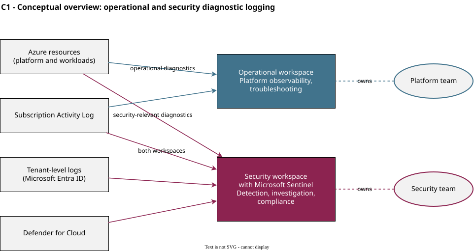
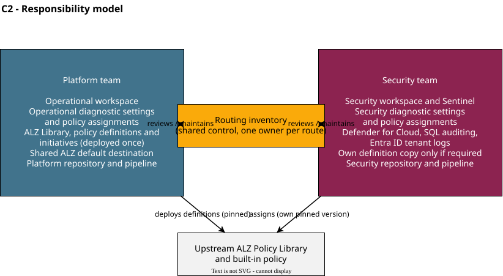
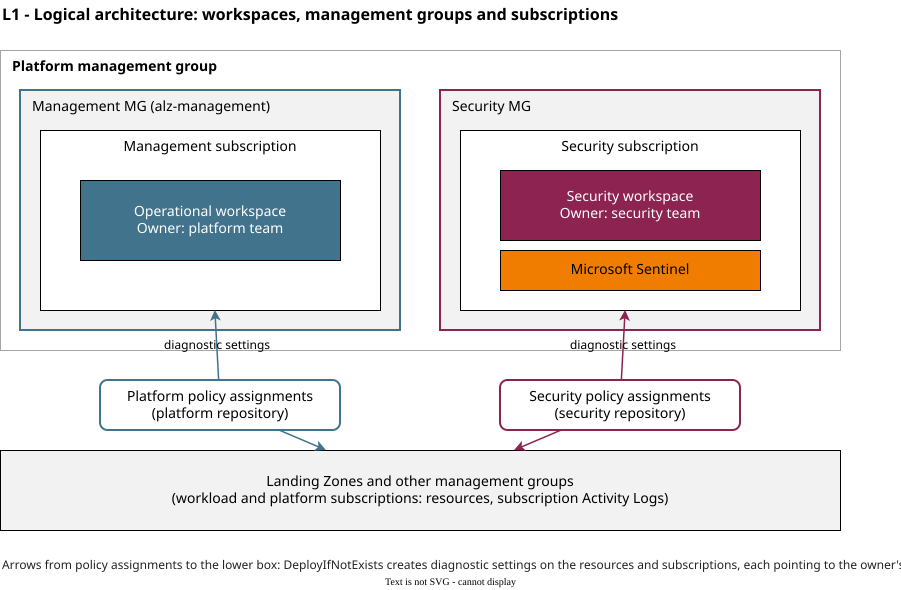
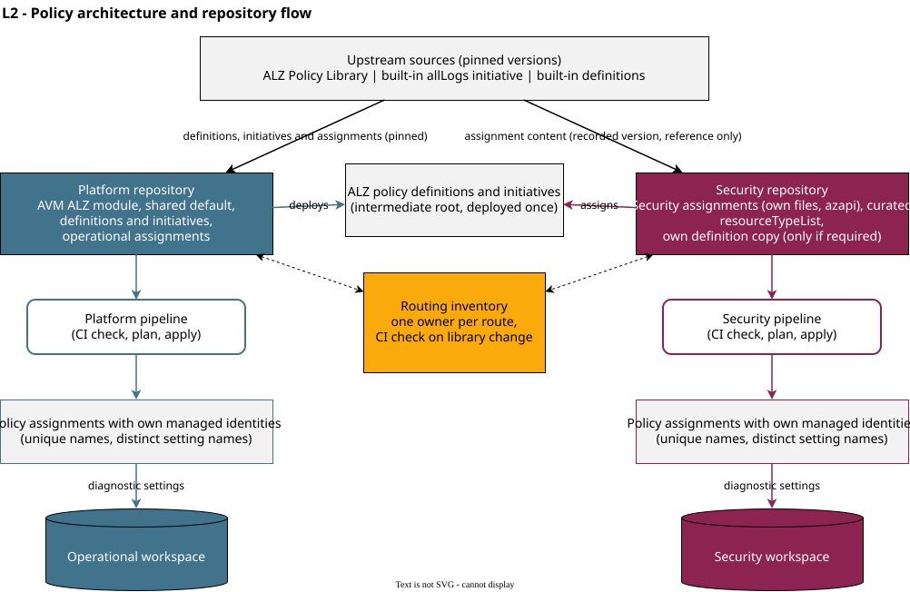
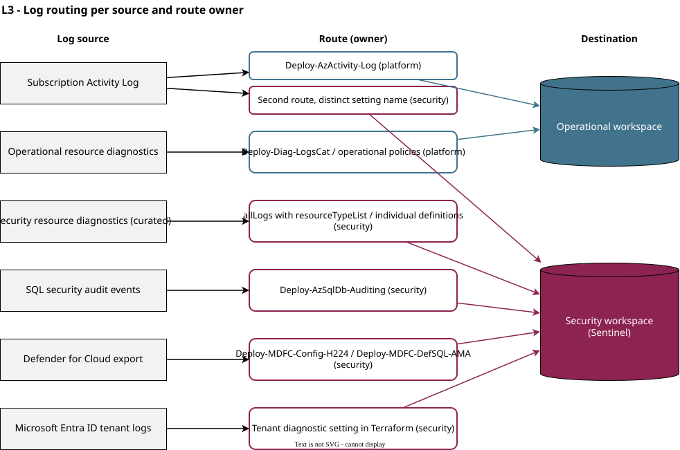

# Design: Separation of Operational and Security Diagnostic Logging in Azure Landing Zones

| Item | Value |
|------|-------|
| Document type | Navigator design (conceptual and logical level) |
| Status | Draft |
| Version | 0.10 |
| Audience | Enterprise architecture review, platform team, security team |

**Version history**

| Version | Description |
|---------|-------------|
| 0.10 | First draft for internal review |

**Conventions used in this document**

| Label | Meaning |
|-------|---------|
| **[Confirmed]** | Claim is supported by cited evidence listed in section 1.6. URLs and access dates identify the consulted source; version-specific library items are re-verified against the pinned version before implementation (section 5.1). |
| **[Recommendation]** | Architectural choice made in this design |
| **[Assumption]** | Statement that is not verified and must be confirmed before implementation (see section 5) |

---

# 1. Introduction

## 1.1 Purpose

This document describes how operational and security diagnostic logging is separated across an Azure environment that is based on Azure Landing Zones (ALZ). It defines the workspace model, the ownership boundaries between the platform team and the security team, the Azure Policy architecture used to deploy diagnostic settings, and the controls that keep the two independently managed deployments consistent.

## 1.2 Background

The Azure platform follows the ALZ architecture, implemented with Azure Verified Modules (AVM) for Terraform and the Azure Landing Zones Policy Library (ALZ Library). Two teams are involved:

- The **platform team** is responsible for ALZ and governance, Azure Policy and policy assignments, centralised monitoring and operational logging, and platform automation.
- The **security team** is responsible for security monitoring, incident detection and investigation, and Microsoft Sentinel.

The default AVM ALZ implementation sends diagnostic data from all ALZ policy assignments to a single central Log Analytics workspace. ALZ has more recently [introduced](https://techcommunity.microsoft.com/blog/azuregovernanceandmanagementblog/a-new-platform-management-group--subscription-for-security-in-azure-landing-zone/4433287) (July 15, 2025) a dedicated Security management group and subscription beneath the Platform management group.

The security subscription is intentionally empty: ALZ deploys no security workspace and no Microsoft Sentinel into it, and no upstream routing model exists for a separate security workspace (Azure/Enterprise-Scale discussions [#1898](https://github.com/Azure/Enterprise-Scale/discussions/1898) and [#1978](https://github.com/Azure/Enterprise-Scale/discussions/1978)). Routing between a management and a security workspace is therefore a local design decision, however the general consensus is the need for separate workspaces for operational and security logging.

## 1.3 Scope

**In scope**

- Two centrally managed Log Analytics workspaces (operational and security) and their relationship.
- Distinction between operational and security diagnostic logging and the assignment of log sources to workspaces.
- Azure Policy architecture for diagnostic settings: ALZ Library consumption, the built-in `allLogs` initiative, individual definitions and custom definitions.
- Ownership, conflict prevention, change review and deployment across the platform and security repositories.
- Workspace access control, data isolation, retention, cost and operational considerations.
- Alternatives considered.

**Out of scope**

- Microsoft Sentinel content (analytics rules, workbooks, playbooks) and SOC processes.
- Sizing of workspaces and commitment tier selection.
- Log collection from virtual machines (Azure Monitor Agent and data collection rules), network flow log design and application-level telemetry.
- Sentinel cost optimisation features (Auxiliary Logs, ingestion-time transformations, data lake); recorded as open question OQ01.
- Detailed Terraform module configuration.

## 1.4 Assumptions

| ID | Assumption |
|----|------------|
| A01 | The platform and security teams use separate Git repositories and separate deployment pipelines. |
| A02 | The platform repository deploys the ALZ Library policy definitions and initiatives at a pinned version through the AVM ALZ Terraform module. The security repository uses the ALZ Library at its own pinned version, deploys only the assignment files it needs and excludes the deployment of policy definitions and initiatives. |
| A03 | The security workspace is created outside ALZ (for example through subscription vending) in the Security subscription beneath the Security management group. |
| A04 | Microsoft Sentinel is enabled on the security workspace only. |
| A05 | Both teams accept the additional ingestion cost of Activity Logs stored in two workspaces. |
| A06 | The Azure environment is a single Microsoft Entra tenant. |

## 1.5 Abbreviations

| Term | Meaning |
|------|---------|
| ALZ | Azure Landing Zones |
| AVM | Azure Verified Modules |
| CAF | Cloud Adoption Framework |
| DCR | Data collection rule |
| DINE | `DeployIfNotExists` policy effect |
| LAW | Log Analytics workspace |
| MG | Management group |
| RBAC | Role-based access control |
| SIEM | Security information and event management |
| SOC | Security operations centre |

## 1.6 References

| Ref | Source | Accessed |
|-----|--------|----------|
| R01 | [Microsoft Learn: Design a Log Analytics workspace architecture (operational and security data)](https://learn.microsoft.com/en-us/azure/azure-monitor/logs/workspace-design#operational-and-security-data) | 2026-11-06 |
| R02 | [Microsoft Learn: Create diagnostic settings at scale by using Azure Policy (log category groups)](https://learn.microsoft.com/en-us/azure/azure-monitor/data-collection/diagnostic-settings-policy) | 2026-11-06 |
| R03 | [Microsoft Learn: Diagnostic settings in Azure Monitor (destinations and limits)](https://learn.microsoft.com/en-us/azure/azure-monitor/data-collection/diagnostic-settings) | 2026-11-06 |
| R04 | [Azure Landing Zones Library](https://github.com/Azure/Azure-Landing-Zones-Library), `alz_policy_default_values.json` and the policy assignments listed in section 4.3 | 2026-11-06 |
| R05 | Azure/Enterprise-Scale discussions [#1898](https://github.com/Azure/Enterprise-Scale/discussions/1898) and [#1978](https://github.com/Azure/Enterprise-Scale/discussions/1978) (security management group and subscription) | 2026-11-06 |
| R06 | [Built-in initiative *Enable allLogs category group resource logging for supported resources to Log Analytics*](https://www.azadvertizer.net/azpolicyinitiativesadvertizer/0884adba-2312-4468-abeb-5422caed1038.html) (`0884adba-2312-4468-abeb-5422caed1038`) | 2026-11-06 |
| R07 | Recommendation from a Microsoft Customer Success Manager | Not publicly accessible |

---

# 2. Summary

## 2.1 Design in brief

Two central Log Analytics workspaces are used. The **operational workspace** is owned by the platform team and receives platform observability and troubleshooting telemetry. The **security workspace** is owned by the security team, has Microsoft Sentinel enabled, and receives log sources with a documented security use case.

Each team deploys its own diagnostic settings through its own repository and its own Azure Policy assignments. The platform team owns and deploys the upstream ALZ Library policy definitions and initiatives once, and the security repository only assigns them. Built-in Azure Policy definitions are used by both. Custom policy content is limited to documented, tracked derivatives. The rule that no policy assignment and no diagnostic setting is managed from both repositories is the central integrity constraint of the design. A reviewed routing inventory, enforced by a continuous integration (CI) check, makes the intended routing visible and detects upstream drift.

## 2.2 Requirements

| ID | Requirement | Priority |
|----|-------------|----------|
| REQ-01 | Security telemetry is isolated from operational telemetry. | High |
| REQ-02 | The security team owns and administers the security workspace, its configuration and its diagnostic policy assignments independently of the platform deployment lifecycle. | High |
| REQ-03 | Retention and lifecycle are defined separately for operational and security data. | Medium/High |
| REQ-04 | Unnecessary ingestion and Microsoft Sentinel cost is avoided. | Secondary |
| REQ-05 | Ownership of every diagnostic setting and policy assignment is unambiguous. | High |
| REQ-06 | Upstream ALZ Policy Library definitions are reused wherever possible. | High |
| REQ-07 | Custom policy maintenance is minimal and upstream drift is manageable. | High |
| REQ-08 | Deployment is consistent and automated through Infrastructure as Code (Terraform). | High |
| REQ-09 | Independently deployed policy assignments do not conflict. | High |
| REQ-10 | Subscription Activity Logs are available in both workspaces. | High |
| REQ-11 | The architecture supports security monitoring and incident investigation. | High |

## 2.3 Design decisions

| ID | Decision | Section |
|----|----------|---------|
| DD01 | Two central Log Analytics workspaces are used: operational and security. | 3.2 |
| DD02 | The security workspace is placed in the Security subscription and is owned and administered by the security team. | 4.1 |
| DD03 | Microsoft Sentinel is enabled on the security workspace only. | 4.1 |
| DD04 | The platform team owns and deploys the ALZ Library policy definitions and initiatives; the platform and security teams deploy their policy assignments through independent repositories. | 3.4 |
| MON01 | The operational workspace is the shared ALZ default destination (`log_analytics_workspace_id`); security routing is explicit. | 4.3 |
| SEC01 | The security workspace receives log sources that have a documented security use case. | 4.2 |
| MON02 | Activity Logs are routed to both workspaces through separate routes, each owned by one repository. | 4.2 |
| SEC02 | The built-in `allLogs` initiative with a curated `resourceTypeList` is used for resource types where all log categories are justified. | 4.3 |
| SEC03 | Individual upstream policy definitions are used where only selected categories are required. | 4.3 |
| DD05 | Custom policy definitions are limited to documented derivatives of upstream definitions. | 4.3 |
| DD06 | The platform repository pins the library and deploys the definitions; the security repository pins the library for its assignments; every upgrade includes the upstream change review and notification of the security team. | 4.3 |
| DD08 | The security team reuses platform-deployed ALZ definitions where identical, and deploys its own renamed copy where an ALZ-defined definition is missing or differs. | 4.3 |
| MON03 | Diagnostic settings that coexist on a resource use distinct names per owner. | 4.4 |
| DD07 | Every policy assignment and diagnostic setting has exactly one owning repository. | 4.4 |
| SEC04 | The Defender for Cloud assignments are owned by the security repository. | 4.4 |
| SEC05 | `Deploy-AzSqlDb-Auditing` is owned by the security repository. | 4.4 |
| SEC06 | Tenant-level logs (Microsoft Entra ID) are owned by the security repository. | 4.4 |
| MON04 | A workspace routing inventory is the routing control and is enforced by a CI check. | 4.5 |
| SEC07 | Workspace access is controlled per workspace; platform access to the security workspace is limited to what is documented in the inventory. | 4.1 |
| SEC08 | Retention is defined per workspace and per data purpose. | 4.1 |

## 2.4 Traceability

| Requirement | Decision(s) | Status |
|-------------|-------------|--------|
| REQ-01 | DD01, DD02, SEC07 | Fulfilled |
| REQ-02 | DD02, DD03, DD04, DD08, SEC04, SEC05, SEC06 | Fulfilled |
| REQ-03 | DD01, SEC08 | Fulfilled (values open, OQ03) |
| REQ-04 | DD03, SEC01, SEC02, SEC03 | Fulfilled |
| REQ-05 | DD07, MON04 | Fulfilled |
| REQ-06 | DD04, MON01, SEC02, SEC03 | Fulfilled |
| REQ-07 | DD05, DD06, DD08, MON04 | Fulfilled |
| REQ-08 | DD04, DD06, MON04 | Fulfilled |
| REQ-09 | DD07, MON03, MON04 | Fulfilled |
| REQ-10 | MON02 | Fulfilled (mechanism to verify, R03) |
| REQ-11 | SEC01, SEC02, SEC06, MON02 | Fulfilled |

## 2.5 Advisory

| ID | Advisory |
|----|----------|
| ADV01 | The ALZ Library is a moving upstream. The April 2026 library changes removed several diagnostic policies. The pinned library version must be inspected before implementation (section 5). |
| ADV02 | The `allLogs` category group is maintained by Microsoft and can gain categories over time. The ingestion volume of an assignment can grow without a change in either repository. |
| ADV03 | Separation removes the possibility of a shared commitment tier discount across both workspaces (section 4.7). |

---

# 3. Conceptual design

Operational observability and security monitoring have distinct owners, access needs and retention drivers. A shared workspace separates them through permissions only, within one administration boundary, which requires continuous coordination between the teams and becomes harder when security operations are handled by a separate team or an external service provider that should only see security telemetry. A dedicated security workspace provides a distinct access and ownership boundary and keeps operational data outside Sentinel pricing. The trade-off is that sources needed by both teams are ingested twice. The following sections define this conceptual model; the logical design describes its implementation.

## 3.1 Operational and security logging

Diagnostic logging is divided by purpose of use, not by technical source.

| Aspect | Operational logging | Security logging |
|--------|---------------------|------------------|
| Purpose | Availability, performance, troubleshooting, capacity, platform observability | Threat detection, incident investigation, audit and compliance evidence |
| Consumers | Platform team, service and application teams | Security team (SOC, incident response) |
| Typical content | Performance and health categories, application and gateway access logs, execution logs | Control-plane activity, authentication and sign-in events, access to sensitive data and secrets, network threat and WAF events, security audit events, Defender for Cloud data |
| Owner | Platform team | Security team |
| Data scope rule | All platform diagnostics required for operations | Sources with a documented security use case |
| Retention driver | Troubleshooting window | Detection, investigation and forensic or compliance needs |

Some sources serve both purposes. A source needed by both teams is sent to both workspaces through two independently owned routes. The classification is a design rule, not a technical property of the log: an operational log can be security-relevant during an investigation, and the security use case determines inclusion in the security workspace (SEC01).

## 3.2 Two-workspace model

The conceptual model has two data stores and two owners (figure C1).

- The **operational workspace** collects platform diagnostics and is administered by the platform team.
- The **security workspace** collects security-relevant telemetry, hosts Microsoft Sentinel and is administered by the security team.
- The workspaces are independent: neither depends on the other for ingestion, access control, retention or lifecycle. Data needed in both is delivered twice at the source rather than copied between workspaces.

**Reasoning (drivers in priority order)**

| Driver | Priority | Effect on the design |
|--------|----------|----------------------|
| Security isolation | High | Security telemetry and its access boundary are separate from ordinary platform operations. |
| Independent security ownership | High | The security team controls the workspace, Sentinel and its policy assignments without depending on the platform release cycle. |
| Separately staffed or outsourced security operations | High | Security staff or a service provider can be granted access to security telemetry without also exposing unrelated operational data. |
| Different retention requirements | Medium/High | Retention and lifecycle are set per workspace. |
| Cost separation | Secondary | Sentinel pricing applies to all data in its enabled workspace, including operational data. A separate workspace keeps operational ingestion out of Sentinel billing; any duplicate ingestion for shared sources is assessed against that avoided cost. |

> Microsoft Learn (R01) states that dedicated workspaces for Azure Monitor and Microsoft Sentinel allow segregation of data ownership between operational and security teams, that all data in a Sentinel-enabled workspace is subject to Sentinel pricing, and that the choice depends on the organisation's security requirements and cost implications. The same source describes a single combined workspace with table-level RBAC as a valid alternative.
The CAF default of one central workspace is therefore not wrong in general; this design applies the documented exception for RBAC and data ownership, because independent security ownership is a high-priority requirement.

Two central Log Analytics workspaces are used: an operational workspace owned by the platform team and a security workspace owned by the security team. This is because the platform team and the security team have different responsibilities, consumers and retention needs for diagnostic data. Security isolation, independent ownership and separately staffed or outsourced security operations are high-priority drivers, and each requires an access boundary around security telemetry that is not shared with ordinary platform operations.

Permissions within a single workspace cannot provide that boundary without continuous coordination between the teams. Retention and lifecycle are set per workspace, so separate workspaces remove the dependency between the teams on these settings. Sentinel pricing applies to all data in a Sentinel-enabled workspace; a dedicated security workspace therefore keeps operational data outside Sentinel billing. Only sources needed by both teams are ingested twice, which is accepted as the cost of the separation.

**DECISION DD01: Two central Log Analytics workspaces are used: an operational workspace owned by the platform team and a security workspace owned by the security team**
- Security isolation, independent ownership and separately staffed or outsourced security operations require a distinct access boundary for security telemetry.
- Retention and lifecycle are set per workspace without dependencies between the teams.
- Operational data stays outside Sentinel billing scope; any duplicate ingestion is limited to sources needed by both teams.

☑ Security Impact: Prevents operational administrators and workloads from holding access to security telemetry through shared workspace permissions, and limits exposure of security data to the security team's access boundary. Establishes a separately administered data store for detection and investigation that remains under security control independent of platform changes.

## 3.3 Responsibilities

| Area | Platform team | Security team |
|------|---------------|---------------|
| Operational workspace | Owns, administers, retention, access | No standing access except as documented |
| Security workspace | No standing access except as documented | Owns, administers, retention, access |
| Microsoft Sentinel | None | Owns |
| Operational diagnostic settings and policy assignments | Owns (platform repository) | Reviews routing inventory |
| Security diagnostic settings and policy assignments | Reviews routing inventory | Owns (security repository) |
| ALZ Library, policy definitions and initiatives (deployment) | Owns (platform repository) | Consumes; reviews changes that affect security assignments |
| ALZ Library version pinned for security assignments | None | Owns; aligned with the deployed definitions |
| Custom policy variants needed for security (DD05) | Reviews | Owns (security repository) |
| Routing inventory | Co-maintains (platform entries) | Co-maintains (security entries) and holds reviewer rights on all entries |

Figure C2 shows the responsibility model.

## 3.4 Independent repositories

The platform team owns and manages the ALZ Library and the policy definitions and initiatives it deploys. These are deployed once, from the existing ALZ repository, at the management group scope where the ALZ Library places them. The platform team also manages the operational diagnostic settings and policy assignments from this repository.

The security team manages security diagnostic settings from a separate security repository. This repository calls the ALZ Library at its own pinned version and deploys only the policy assignments it needs, with deployment of definitions and initiatives excluded. The assignments reference the definitions and initiatives that the platform repository has already deployed, and the security team selects and configures the parameters, scopes and workspace destination of the assignments it owns. Policy definitions and initiatives are not deployed a second time, and the ALZ Library is not copied into a shared derivative.

The exception is a definition or initiative that the security team needs but cannot reuse from the platform deployment. This applies when the definition is defined by the ALZ Library itself (not built into Azure), and either only exists in a newer library version than the platform has deployed, or differs from the deployed one in parameters or behaviour. The security team then deploys its own copy from its pinned library version, under a distinct name, instead of waiting for a platform upgrade (section 4.3, DD05). Built-in Azure Policy definitions and initiatives are not deployed by the ALZ Library, so they create no dependency on the platform team.

**DECISION DD04: The platform team owns and deploys the ALZ Library policy definitions and initiatives, and the platform and security teams deploy their policy assignments through independent repositories**
- Policy definitions and initiatives are deployed once, which avoids duplicate definitions, version divergence and a second library lifecycle to maintain.
- Independent security ownership requires that security assignments are not part of the platform deployment lifecycle. Only the assignment, not the definition, is separated.
- The security repository depends on the platform repository for the availability and version of the ALZ-defined definitions it assigns. This dependency is limited to library-defined content, and a security-owned copy under a distinct name removes it where the platform version does not fit (section 4.3). The coordination mechanisms in sections 4.4 and 4.5 manage the remaining dependency and replace the coupling that a shared repository would provide.

☑ Security Impact: Prevents platform pipeline changes or platform administrators from altering or removing security diagnostic policy assignments. Establishes a security-controlled change path for security log collection. The platform team still controls the definitions the assignments reference, which is why DD06 requires notification of the security team before library upgrades.

## 3.5 Alternatives considered

Three alternatives are evaluated. Alternative C is the selected alternative.

### Alternative A: Single central workspace shared by platform and security

One workspace receives all diagnostic data; Sentinel is enabled on it. This is the AVM ALZ default and the CAF default recommendation. Table-level RBAC and resource-context access restrict security tables.

| Aspect | Assessment |
|--------|------------|
| Advantages | Lowest complexity; one set of ALZ policy assignments; combined queries across operational and security data; possible shared commitment tier discount (R01); no duplicated Activity Log ingestion. |
| Disadvantages | All data, including operational data, is billed at Sentinel rates; security isolation depends on table-level RBAC and continuous permission management; security cannot change workspace configuration independently; retention is per table and shared administration remains; one team's change affects the other. |
| Fit to requirements | Meets REQ-06 to REQ-08 best. Meets REQ-01 and REQ-02 only partly and with ongoing coordination effort. REQ-04 is not met. |

### Alternative B: Two workspaces, both managed by the platform team

Two workspaces exist, but one repository and one team deploy all diagnostic settings and policy assignments for both.

| Aspect | Assessment |
|--------|------------|
| Advantages | Single repository and pipeline; no cross-repository ownership conflicts; one team resolves duplicate-route and naming issues; Sentinel ingestion scope is controlled. |
| Disadvantages | The security team depends on the platform release cycle and priorities for every change to security log collection; the platform team holds administrative control over security collection configuration; the platform team must understand security log requirements; REQ-02 is not met. |
| Fit to requirements | Meets REQ-01, REQ-03, REQ-04 and REQ-09. REQ-02 is not met. |

### Alternative C: Two workspaces with independent platform and security repositories (selected)

| Aspect | Assessment |
|--------|------------|
| Advantages | Meets all high-priority drivers; security controls its own assignments, categories and lifecycle; the Microsoft solution architect engagement (R07) recommended separate workspaces, repositories and assignments; upstream library reuse is retained. |
| Disadvantages | Duplicated assignments for sources needed in both workspaces; risk of conflicting diagnostic settings on the same resource; two assignment lifecycles that depend on one platform-managed library lifecycle; dual Activity Log ingestion cost; additional governance (routing inventory, CI check). |
| Fit to requirements | Meets REQ-01 to REQ-11 provided the controls in section 4 are implemented. |

### Comparison

| Criterion | A: Single workspace | B: Two workspaces, platform manages both | C: Two workspaces, independent repositories |
|-----------|--------------------|------------------------------------------|---------------------------------------------|
| Security isolation (REQ-01) | Medium (RBAC dependent) | High | High |
| Independent security ownership (REQ-02) | Low | Low | High |
| Separate retention (REQ-03) | Medium (per table) | High | High |
| Sentinel cost scope (REQ-04) | Low | High | High |
| Policy conflict risk (REQ-09) | Low | Low | Medium (controlled by MON03, DD07, MON04) |
| Operational complexity | Low | Medium | High |
| Upstream drift effort | Low | Medium | Medium to high (two consumers) |

Alternative C is selected because security isolation and independent ownership are the two high-priority drivers, and only Alternative C meets both. The additional complexity is accepted and mitigated by explicit ownership rules and the routing inventory.

### Default destination of the shared ALZ workspace parameter

The ALZ Library maps one shared default (`log_analytics_workspace_id`) to five assignments (section 4.3). One of the two workspaces must serve as that default.

| Option | Description | Assessment |
|--------|-------------|------------|
| 1: Operational workspace as default | Security routes are explicit overrides or separate assignments. | Aligns with ALZ intent, so upstream documentation and updates apply without translation. Security routing is explicit in code. A new upstream workspace-dependent assignment inherits the operational workspace until reviewed. |
| 2: Security workspace as default | Operational routes are explicit overrides or duplicates. | A new assignment lands with security by default. The default covers Activity Logs, SQL auditing and broad resource diagnostics, so high volumes of operational data reach the Sentinel-billed workspace unless overridden. |

The argument for option 2 is that an omitted assignment lands with security rather than being missed. That protection is limited: the default changes only the destination of an unreviewed route, it does not create the second copy that dual-destination sources need, and either default requires review when the library changes. The control that addresses the concern is the routing inventory with its CI check (MON04), which is independent of the default.

## 3.6 Conceptual diagrams

| Figure | File | Purpose |
|--------|------|---------|
| C1 | [C1-conceptual-overview.drawio](./diagrams/C1-conceptual-overview.drawio) | Two workspaces, their sources and owners |
| C2 | [C2-responsibility-model.drawio](./diagrams/C2-responsibility-model.drawio) | Responsibilities of the platform and security teams |

---

# 4. Logical design

## 4.1 Workspace architecture

### Placement and ownership

The operational workspace is the existing workspace in the management subscription in the Platform management group (`alz-management`). The security workspace is placed in the Security subscription beneath the Security management group.

**DECISION DD02: The security workspace is placed in the Security subscription and is owned and administered by the security team**
- The Security management group and subscription are the upstream-aligned location for security infrastructure.
- Subscription-level ownership separates administrative control and billing from the platform.
- Independent ownership is a high-priority requirement (REQ-02).

☑ Security Impact: Prevents platform subscription administrators from inheriting control of the security workspace through subscription or management group role assignments. Establishes an administrative boundary aligned with the security team's responsibility.

**DECISION DD03: Microsoft Sentinel is enabled on the security workspace only**
- All data in a Sentinel-enabled workspace is billed at Sentinel rates (section 3.2).
- Operational data therefore remains outside Sentinel billing scope.
- Sentinel and Defender for Cloud data are kept together in the security workspace, as advised by Microsoft (R07).

### Access control and data isolation

Azure Monitor supports workspace-level RBAC, resource-context access and table-level read access (R01). The design uses workspace-level separation as the primary boundary and does not depend on table-level RBAC for isolation between the teams.

| Aspect | Operational workspace | Security workspace |
|--------|-----------------------|--------------------|
| Administrators | Platform team | Security team |
| Readers | Platform team, service teams per access model of the platform | Security team (SOC, incident response) |
| Cross-team access | Security: no standing access | Platform: no standing access |
| Break-glass or incident access | Documented in the routing inventory | Documented in the routing inventory |
| Access to data from resource owners | Resource-context access as defined by the platform | Not granted by default |
| Policy assignment identities | Write access to the operational workspace only for assignments owned by the platform repository | Write access to the security workspace only for assignments owned by the security repository |

**DECISION SEC07: Access to each workspace is controlled by workspace-level role assignments owned by the workspace owner, and platform access to the security workspace is limited to documented, reviewed exceptions**
- Workspace-level separation avoids the permission-management overhead of table-level RBAC across teams.
- Role assignments of policy managed identities follow the repository that owns the assignment, so a platform identity holds no write access to the security workspace.
- Exceptions are recorded in the routing inventory, where both teams can review them.

☑ Security Impact: Prevents unauthorised read or tamper access to security telemetry by platform administrators and automation identities. Establishes least-privilege access aligned with team ownership and provides an auditable exception list.

### Retention and lifecycle

Retention is defined per workspace and per data purpose, based on the following data classes.

| Data class | Description | Workspace |
|------------|-------------|-----------|
| Detection data | Logs used by Sentinel analytics and detections | Security |
| Investigation data | Logs required to establish timelines during incidents | Security |
| Forensic or compliance retention | Data retained longer for audit or regulation, not used continuously | Security (retention values and tiering by the security team) |
| Operational telemetry | Logs for reliability, performance and troubleshooting | Operational |

**DECISION SEC08: Retention is defined independently for the operational and the security workspace, and the security workspace distinguishes detection, investigation and forensic or compliance retention**
- Operational and security data have different retention, investigation and compliance needs (REQ-03).
- The data classes in this section give each log source an explicit retention purpose.

☑ Security Impact: Prevents loss of investigation and compliance evidence through short operational retention settings. Establishes retention governed by the security team for security data.

### Logical architecture

Figure L1 shows the workspaces, subscriptions, policy assignment scopes and Sentinel.

## 4.2 Diagnostic logging strategy

### Assignment of sources to workspaces

Resources are assigned to a workspace by routing of their diagnostic settings, not by their location. The decision is made per log source and recorded in the routing inventory (section 4.5).

| Class | Rule | Examples |
|-------|------|----------|
| Operational only | Needed for operations, no documented security use case | App Service HTTP and console logs, Functions execution logs, Container Apps console and system logs, API Management gateway logs, Application Gateway access logs, Data Factory run logs, Databricks execution logs, SQL performance categories (SQLInsights, AutomaticTuning, QueryStore*, Blocks, Timeouts), Redis performance logs, Azure Automation job streams |
| Security only | Needed for detection or investigation, no operational need | Microsoft Entra ID sign-in and audit logs, Defender for Cloud export, SQL security audit events |
| Both | Needed for both purposes | Subscription Activity Log; selected categories of resources that are both operated and monitored for threats, for example Key Vault audit events, Azure Firewall logs |

The lists are examples, not fixed exclusions. **[Assumption]** Each item requires confirmation of its use case by the owning team before inclusion (A08 and OQ04).

### Security log sources and categories

| Source | Collection mechanism | Notes |
|--------|----------------------|-------|
| Subscription Activity Log (control plane, role assignments, policy changes) | Subscription diagnostic setting | Also required operationally (MON02) |
| Microsoft Entra ID sign-in, audit and service principal sign-in logs | Tenant-level diagnostic setting | Not an Azure resource diagnostic setting; owned by security (SEC06) |
| Defender for Cloud (continuous export) | Defender for Cloud export configuration | Owned by security (SEC04) |
| Key Vault audit events | Resource diagnostic settings | Category selection |
| SQL security audit events | SQL auditing / resource diagnostic settings | Owned by security (SEC05) |
| Azure Firewall network, application and threat intelligence logs | Resource diagnostic settings | |
| Application Gateway and Azure Front Door WAF logs | Resource diagnostic settings | Distinguish from access logs |
| Storage read, write and delete operations (sensitive stores) | Resource diagnostic settings | Selected storage accounts |
| Azure Container Registry authentication and audit events | Resource diagnostic settings | |
| AKS Kubernetes API audit logs and control plane logs | Resource diagnostic settings | |
| NSG flow logs | Flow log configuration | Where justified; out of scope for this document |

**DECISION SEC01: The security workspace receives log sources and categories that have a documented security use case**
- Sentinel billing applies to all data in the security workspace, so unused data generates cost without detection value (section 3.2).
- Resource-type-level or category-level inclusion with a recorded rationale keeps ingestion explicit.
- The documented use case is recorded in the routing inventory.

☑ Security Impact: Prevents noise that obscures detections and reduces investigation efficiency. Establishes a documented collection baseline that can be reviewed against detection and compliance needs.

### Resources that require logging in both workspaces

A diagnostic setting can define at most one destination of each type, so sending to two Log Analytics workspaces requires two diagnostic settings, and a resource supports at most five diagnostic settings (R03).

For a resource that must reach both workspaces:

1. Each repository creates its own diagnostic setting with its own destination and its own setting name (MON03).
2. Each setting selects only the categories that its owner requires.
3. The inventory records both routes and their owners (MON04).

For the subscription Activity Log, the platform repository keeps the library assignment `Deploy-AzActivity-Log` routed to the operational workspace through the shared default. The security repository creates a second route to the security workspace. The upstream Activity Log definition uses a fixed diagnostic setting name. A second assignment of the same definition therefore gives an error. To work around this, the security route uses a custom variant with a distinct assignment name.

**DECISION MON02: Activity Logs are routed to both workspaces through two routes, each with one owning repository and a distinct diagnostic setting name**
- Activity Logs support both operational and security use cases (REQ-10).
- Two Log Analytics destinations require two diagnostic settings (R03).
- One owner per route prevents competing management of the same setting.

☑ Security Impact: Prevents loss of control-plane audit data in the security workspace if the platform route changes or is removed. Establishes independently controlled retention of administrative activity evidence.

## 4.3 Azure Policy architecture

### ALZ Library consumption

The ALZ Library defines a shared default `log_analytics_workspace_id` that the ALZ provider applies to the following assignments (R04):

| Policy assignment | Parameter | Purpose |
|-------------------|-----------|---------|
| `Deploy-AzActivity-Log` | `logAnalytics` | Subscription Activity Logs |
| `Deploy-AzSqlDb-Auditing` | `logAnalyticsWorkspaceId` | SQL auditing |
| `Deploy-Diag-LogsCat` | `logAnalytics` | Supported resource diagnostic logs |
| `Deploy-MDFC-Config-H224` | `logAnalytics` | Defender for Cloud continuous export |
| `Deploy-MDFC-DefSQL-AMA` | `userWorkspaceResourceId` | Defender for SQL AMA collection |

The default supplies one workspace ID per parameter. It does not discover workspaces, create a second destination or establish ownership. The values in the library are placeholders and must be replaced by real workspace resource IDs.

**DECISION MON01: The operational workspace is the shared ALZ default destination (`log_analytics_workspace_id`) and security routes are explicit**
- The default aligns with the ALZ intended architecture, so upstream guidance and updates apply directly (section 3.5).
- Security-specific routing is visible in the security repository and in the routing inventory.
- The default is not treated as the routing policy; the inventory is (MON04).

☑ Security Impact: Prevents unintended routing of operational volume to the Sentinel-billed workspace, and limits the security workspace to deliberately selected sources. Establishes explicit, reviewable security routing.

### Independent assignments

Each repository assigns the policies it owns at its own scopes with its own managed identities. Assignment names are unique across repositories, and no assignment name or policy is assigned from both repositories (DD07). The platform repository disables or removes any library assignment that the security repository takes over, before the security repository assigns it.

### Policy selection approach

Three mechanisms are used, in order of preference.

| Order | Mechanism | Use when | Limitation |
|-------|-----------|----------|------------|
| 1 | Built-in `allLogs` initiative with curated `resourceTypeList` | All log categories of a resource type are justified | Cannot select categories within a resource type; included types deploy the `allLogs` category group |
| 2 | Individual upstream policy definitions | Only selected categories are required for a resource type | One assignment or definition per resource type; more assignments to maintain |
| 3 | Custom definition (derived from upstream) | Upstream cannot provide the required behaviour | Maintenance effort and drift risk |

#### The `allLogs` initiative

The built-in initiative `0884adba-2312-4468-abeb-5422caed1038` exposes a `resourceTypeList` parameter. Policy references for resource types outside the list are set to `Disabled`. For included types the `allLogs` category group is deployed. A category group is updated dynamically by Microsoft when categories are added (R02, R06). The initiative therefore selects resource types, not categories.

Consequences:

- The upstream initiative is reused without a custom initiative to exclude whole resource types.
- The effective categories can grow without a change in the repository (ADV02), which can raise ingestion in the Sentinel-billed workspace. The inventory records the resource types and the review on upgrade covers category group changes.
- `allLogs` is not applied to all supported resource types by default. Each type in the list has a recorded security use case (SEC01).

**DECISION SEC02: The built-in `allLogs` initiative with a curated `resourceTypeList` is assigned from the security repository for resource types where all log categories have a security use case**
- The initiative is maintained upstream and avoids a custom initiative (REQ-06, REQ-07).
- `resourceTypeList` limits ingestion to listed resource types (REQ-04).
- Each listed type has a documented use case (SEC01).

☑ Security Impact: Prevents gaps in security log collection for listed resource types by deploying all current and future categories of the category group. Establishes upstream-maintained collection coverage with an explicit resource type scope.

#### Individual definitions

Where only some categories are required, individual upstream definitions are assigned. SQL is an example: SQL security audit events are collected for the security workspace, while performance and troubleshooting categories are collected for the operational workspace.

**DECISION SEC03: Individual upstream policy definitions are assigned where only selected categories of a resource type have a security use case**
- `resourceTypeList` cannot select categories within a resource type (section 4.3).
- Individual definitions avoid collecting categories without detection or investigation value (REQ-04).

#### Custom definitions

A custom definition is used only when an upstream definition cannot meet the requirement, for example when a diagnostic setting name is fixed and the same resource must send data to two workspaces, or when categories cannot be selected as required.

Custom definitions follow these rules:

| Rule | Description |
|------|-------------|
| Baseline | Start from the upstream definition and change only the required behaviour |
| Rationale | Record the reason and the upstream definition and version it derives from |
| Allowlist | For a custom initiative, keep an explicit allowlist of included policy reference IDs with an inclusion or exclusion reason |
| Tracking | Compare the derivative with upstream on every library or Azure Policy upgrade and review added, changed and removed references |
| Retirement | Remove the derivative when upstream provides an equivalent capability |

Initiative assignment effect overrides, which disable individual policy references in an upstream initiative, are a secondary option. They keep the upstream initiative but make the effective configuration less visible to reviewers; the supported syntax and behaviour are verified for the specific initiative before use. Policy exemptions are used for documented exceptions, not to prune a baseline.

**DECISION DD05: Custom policy definitions and initiatives are limited to documented derivatives of upstream definitions with a defined upstream comparison step**
- Custom policy increases maintenance and drift (REQ-07).
- Derivatives with a rationale and comparison keep drift visible and reviewable.

### Dependency on platform-deployed definitions

The platform repository deploys the ALZ Library definitions and initiatives at its pinned version X. The security repository pins a version Y of the library for its assignments, and Y can be newer than X. The effect on a security assignment depends on the kind of definition it references.

| Case | Example | Effect | Handling |
|------|---------|--------|----------|
| The definition is built into Azure Policy | `Deploy-Diag-LogsCat`, `Deploy-AzActivity-Log`, `Deploy-AzSqlDb-Auditing`, `Deploy-MDFC-DefSQL-AMA`, and the `allLogs` initiative and individual definitions of SEC02 and SEC03 | No dependency on the platform deployment. The definition exists in the tenant independent of the library version. | Assign directly from the security repository. |
| The definition is defined by the ALZ Library and is identical in X and Y | The same custom definition in both versions | Reused from the platform deployment. | Assign and record the source in the inventory. |
| The definition is defined by the ALZ Library and only exists in Y, or differs between X and Y | `Deploy-MDFC-Config_20240319` and its member `Deploy-ASC-SecurityContacts` for `Deploy-MDFC-Config-H224` | A missing definition fails the deployment. A changed parameter set fails the deployment. A changed behaviour behind an unchanged name changes collection without an error. | The security team deploys its own copy under a distinct name. |

In the library version inspected on 2026-11-07 (commit `62cfa7f`, ALZ dependency 2026.11.0), the diagnostic and Defender assignments in section 4.3 all reference built-in definitions, except `Deploy-MDFC-Config-H224`. The `Deploy-Diagnostics-*` definitions that the library deploys are not referenced by any assignment or initiative in that version, and security does not build on them. The dependency on the platform deployment is therefore currently limited to the Defender for Cloud configuration (SEC04).

A security-owned copy follows these rules, in addition to those in the previous section:

| Rule | Description |
|------|-------------|
| Name | A distinct name with a security prefix, for example `Sec-Deploy-MDFC-Config_20240319`. The copy is deployed at the same scope as the platform-deployed definitions, so a name that matches an existing definition would collide with it |
| References | A copied initiative references the copied member definitions, not the platform-deployed ones |
| Scope | Deployed at the intermediate root management group, together with the other ALZ policy definitions, so that a security assignment at that scope covers the whole platform. A definition can only be assigned at its own scope or below |
| Retirement | Removed when the platform deployment reaches an equivalent version and the assignment is switched back |

**DECISION DD08: The security team reuses platform-deployed ALZ definitions where they are identical to the version it assigns, and deploys its own renamed copy where an ALZ-defined definition is missing or differs**
- A hard dependency on the platform upgrade schedule for security log collection is avoided where it matters.
- The copy is limited to ALZ-defined content. Built-in definitions need no copy.
- The cost of the copy is small because the security team assigns a small number of initiatives, and the platform team continues to own the rest of the library.

☑ Security Impact: Prevents the security team from being blocked by the platform team's library upgrade schedule, and prevents silent change in collection behaviour through a changed definition behind an unchanged name. Establishes a controlled, documented fallback for security-owned policy content.

### Versioning and drift

The security repository uses the ALZ Library at its own pinned version, and deploys only the assignment files it needs. Deployment of policy definitions and initiatives is excluded in this repository. The security team therefore pins the library version to control which assignments it deploys, but it does not own the definitions. Its pinned version is kept aligned with the definitions the platform repository has deployed, because the assignments reference those definitions and their parameters. The platform team notifies the security team before every library upgrade that changes a definition or initiative the security repository assigns. An upgrade follows this process:

1. Review new, removed and changed assignments, initiatives, definitions and workspace-dependent parameters in the target version.
2. Notify the security team of changes to definitions or initiatives that security assignments reference, so that security can review the effect on its assignments before the upgrade is deployed.
3. Update the pinned library version, routing inventory and Terraform configuration of each affected repository in the same change window, so that the security repository's pinned version stays aligned with the deployed definitions.
4. Compare custom derivatives with their upstream definitions.
5. Verify that no policy is assigned from both repositories.
6. Deploy to a non-production scope and verify resulting diagnostic settings and ingestion before broad assignment.

**DECISION DD06: The platform repository pins the ALZ Library and deploys the definitions, the security repository pins the library for its assignments, and every upgrade includes the upstream change review and notification of the security team**
- Pinning prevents silent changes to diagnostic behaviour (REQ-07, REQ-08).
- Library changes affect workspace-dependent assignments and the routing inventory.
- Security assignments depend on platform-deployed definitions. Notification before upgrade lets the security team review parameter changes, removed policies and category changes before they reach security log collection.

☑ Security Impact: Prevents uncontrolled changes to security log collection through upstream updates. Establishes reviewed, versioned security policy content, with the security team informed of every change to the definitions it assigns.

Figure L2 shows the policy and repository flow.

## 4.4 Ownership and conflict prevention

### Ownership matrix

| Area | Owner | Notes |
|------|-------|-------|
| Operational workspace default (`log_analytics_workspace_id`), library assignments and operational routes (`Deploy-AzActivity-Log`, `Deploy-Diag-LogsCat` to the operational workspace) | Platform repository | |
| Security routes: second Activity Log route, security diagnostic policies (`allLogs` with curated list, individual definitions) | Security repository | Security selects categories |
| `Deploy-MDFC-Config-H224`, `Deploy-MDFC-DefSQL-AMA` | Security repository | Decision SEC04; recorded as to be confirmed (OQ02) |
| `Deploy-AzSqlDb-Auditing` | Security repository | Decision SEC05 |
| Tenant-level logs (Microsoft Entra ID) | Security repository | Decision SEC06 |
| Routing inventory and CI check | Both repositories | Security holds reviewer rights on all entries |

**DECISION DD07: Every policy assignment and every diagnostic setting has exactly one owning repository, and no policy is assigned from both repositories**
- Diagnostic settings are child resources, but policy definitions can use fixed setting names; two assignments that manage the same name can overwrite each other regardless of the repository they are deployed from (REQ-09).
- Single ownership makes responsibility and change review unambiguous (REQ-05).

☑ Security Impact: Prevents one repository from silently overwriting or disabling security log routing configured by the other. Establishes a verifiable ownership boundary for security log collection.

**DECISION MON03: Diagnostic settings that coexist on a resource use distinct names per owning repository**
- A resource supports at most five diagnostic settings, and two Log Analytics destinations require two settings (section 4.2).
- Distinct names prevent overwrites; the policy definition must expose or support a distinct name (verified per definition, DD05).

☑ Security Impact: Prevents overwriting of the security diagnostic setting by an operational policy and the reverse. Establishes independent, coexisting settings per workspace.

### Defender for Cloud, SQL auditing and tenant-level logs

**DECISION SEC04: The Defender for Cloud assignments `Deploy-MDFC-Config-H224` and `Deploy-MDFC-DefSQL-AMA` are owned by the security repository**
- Defender for Cloud data is not required in the operational workspace.
- Microsoft advises keeping Sentinel and Defender for Cloud data in the same workspace (R07).
- `Deploy-MDFC-Config-H224` also contains the security contact and export resource group parameters, so the security team owns the whole assignment, not only the destination.

Implementation conditions:

- The assignments are disabled or removed in the platform repository first (for example through the archetype or `DoNotEnforce`; the mechanism is verified for the module version).
- `Deploy-MDFC-DefSQL-AMA` also depends on the AMA managed identity and Defender for SQL data collection rule defaults from the platform side; the receipt of these values is agreed between the teams.
- Both assignments exist at several management group scopes; all scopes are covered.
- The security team reviews the effect of platform library upgrades on the definitions it assigns (DD06).
- This decision uses the current leaning and is to be confirmed (OQ02).

☑ Security Impact: Prevents Defender for Cloud export configuration from being changed by the platform team. Establishes security control over Defender for Cloud data and its destination.

**DECISION SEC05: `Deploy-AzSqlDb-Auditing` is owned by the security repository and SQL security audit events are routed to the security workspace**
- SQL security audit events are a security signal.
- SQL performance and troubleshooting categories remain in the operational workspace through operational policy.
- The upstream SQL auditing definition (version `1.0.2`) uses a fixed diagnostic setting name (`SQLSecurityAuditEvents_3d229c42-c7e7-4c97-9a99-ec0d0d8b86c1`). Single ownership avoids a collision; if both workspaces require SQL audit events, a custom variant with a distinct name is used (DD05).

☑ Security Impact: Prevents security audit events from being collected through operational configuration that security does not control. Establishes security-owned SQL audit collection.

**DECISION SEC06: Tenant-level logs such as Microsoft Entra ID are owned by the security repository and defined in Terraform**
- Tenant-level logs are not collected through Azure resource diagnostic policy and are security signals (section 4.2).
- Provisioning requires specific Microsoft Entra and provider permissions, which are held by the security team's pipeline identity.

☑ Security Impact: Prevents tenant identity logs from being missing from the security workspace or altered by the platform pipeline. Establishes security-controlled identity telemetry.

### Change review and deployment

| Change | Reviewers | Deployment |
|--------|-----------|------------|
| Platform repository: operational assignments, shared default, ALZ Library and policy definitions, library upgrade | Platform team; security reviews routing inventory changes and is notified of library upgrades (DD06) | Platform pipeline |
| Security repository: security assignments, `resourceTypeList`, custom derivatives, pinned library version for its assignments | Security team; platform reviews routing inventory changes and cross-repository naming conflicts | Security pipeline |
| Routing inventory | Both teams (security mandatory reviewer) | Merged with the related Terraform change |

## 4.5 Routing inventory as a control

The default workspace value answers which workspace an assignment gets. The routing inventory answers where each required log source goes, who owns the route and how it is verified. The inventory is therefore the routing policy; the default is a fallback.

**Inventory fields**

| Field | Content |
|-------|---------|
| Assignment or source | Policy assignment name or log source |
| Parameter or route | Workspace parameter name or diagnostic setting route |
| Destination | Operational, security or both |
| Owner | Owning repository, one per route |
| Duplicate route required | Whether a second assignment or route exists, and its owner |
| Dependencies | Identity permissions, shared inputs, prerequisites |
| Use case | Security or operational rationale (SEC01) |
| Definition source | Built-in, ALZ-defined reused from the platform deployment, or security-owned copy (DD08), with the library version for ALZ-defined content |
| Verification | How the diagnostic setting and ingestion are confirmed |

**Initial inventory**

| Assignment or source | Parameter or route | Destination | Owner | Duplicate route |
|----------------------|--------------------|-------------|-------|-----------------|
| `Deploy-AzActivity-Log` | `logAnalytics` | Operational (default) | Platform | Yes, security route (security repo) |
| Activity Log, security route | Diagnostic setting, distinct name | Security | Security | n/a |
| `Deploy-Diag-LogsCat` | `logAnalytics` | Operational | Platform | Yes, for selected categories in the security repo |
| Security resource diagnostics (`allLogs` with curated list, individual definitions) | Per assignment | Security | Security | n/a |
| `Deploy-AzSqlDb-Auditing` | `logAnalyticsWorkspaceId` | Security | Security | No |
| `Deploy-MDFC-Config-H224` | `logAnalytics` | Security | Security | No |
| `Deploy-MDFC-DefSQL-AMA` | `userWorkspaceResourceId` | Security | Security | No |
| Microsoft Entra ID tenant logs | Tenant diagnostic setting | Security | Security | No |

**Operation of the control**

1. **Library upgrade review:** the inventory is reviewed on every library version change (DD06).
2. **CI check:** the pipeline fails when an enabled workspace-dependent assignment or parameter in the pinned library has no inventory entry. The check evaluates the assignment and parameter relationship at the intended scope, not only the presence of a workspace ID string. Completeness of required inventory fields is also checked. The check starts with detection of unreviewed library changes and is extended where practical.
3. **Deployed routing verification:** after deployment, assignments at the intended scopes and workspace IDs, assignment identity permissions, diagnostic setting names and categories on representative resources, and arrival of representative data in each required workspace are confirmed. An existing assignment alone does not prove that data arrives.
4. **Security visibility:** the security team holds mandatory reviewer rights on the inventory.

**DECISION MON04: A workspace routing inventory is maintained in both repositories as the routing control and a CI check fails when a workspace-dependent assignment lacks an inventory entry**
- A shared default supplies one destination and does not create duplicates or ownership (section 4.3).
- The failure mode of a missed assignment exists under either default, so a process control is required (section 3.5).
- The inventory provides the security team with assurance without routing all operational data to the security workspace.

☑ Security Impact: Prevents silently unrouted or misrouted security log sources after upstream changes. Establishes a reviewed, enforceable record of intended routing.

Figure L3 shows the routing per log source.

## 4.6 Security monitoring and incident investigation

The design supports monitoring and investigation as follows:

| Capability | Provided by |
|------------|-------------|
| Detection | Sentinel on the security workspace with curated, documented sources (SEC01, SEC02, SEC03) |
| Administrative activity | Activity Log in the security workspace (MON02) |
| Identity activity | Entra ID logs in the security workspace (SEC06) |
| Defender for Cloud alerts and exports | Security workspace, owned by security (SEC04) |
| Investigation timelines | Investigation data class with security-defined retention (SEC08) |
| Operational context | Operational workspace remains available to the security team through a documented, reviewed access exception where an investigation requires it (SEC07) |
| Verification of collection | Routing inventory and post-deployment verification (MON04) |

Investigations that need operational context query the operational workspace under the documented exception, or use targeted extension of the security routing for the affected resource types through the security repository.

## 4.7 Cost and operational considerations

### Ingestion, retention and Sentinel cost

| Topic | Consideration |
|-------|---------------|
| Sentinel scope | All data in the security workspace is billed at Sentinel rates. Operational data is kept out of the workspace by SEC01 and MON01. |
| Duplicated ingestion | Activity Logs and any dual-routed category are billed in both workspaces. Accepted (A05). |
| Category group growth | `allLogs` can expand over time (ADV02); the inventory review includes category group changes. |
| Commitment tiers | Combining data in one workspace can reach a higher commitment tier with a larger discount (R01). Two workspaces forgo that combined discount (ADV03). Tiers are evaluated per workspace (out of scope). |
| Retention | Sentinel workspaces include three months of free retention (R01). Longer retention for forensic or compliance data is a cost item for the security team. |
| Options for high-volume sources | Auxiliary Logs, ingestion-time transformations and the data lake are not covered and are open (OQ01). |

### Operational overhead

| Area | Overhead | Mitigation |
|------|----------|------------|
| Two workspaces | Two sets of access control, retention and monitoring configuration | Separate owners, no shared administration |
| Duplicated assignments | More assignments and diagnostic settings, near the five-setting limit per resource | Inventory records dual routes; distinct names (MON03) |
| One library lifecycle, two assignment lifecycles | Security assignments depend on platform-deployed definitions | Platform pins versions, security pins its assignment source, platform notifies security before upgrades, upgrade review (DD06, MON04) |
| Custom derivatives | Ongoing comparison with upstream | Keep to a minimum (DD05) |
| Cross-team coordination | Naming, ownership boundaries, shared inputs | Ownership matrix, reviewer rights |

## 4.8 Logical diagrams

| Figure | File | Purpose |
|--------|------|---------|
| L1 | [L1-logical-architecture.drawio](./diagrams/L1-logical-architecture.drawio) | Workspaces, subscriptions, management groups, Sentinel |
| L2 | [L2-policy-repository-flow.drawio](./diagrams/L2-policy-repository-flow.drawio) | Repositories, ALZ Library, policy definitions and assignments, managed identities |
| L3 | [L3-log-routing.drawio](./diagrams/L3-log-routing.drawio) | Routing of log sources to workspaces and their owners |

---

# 5. Risks, dependencies and open questions

## 5.1 Verification items before implementation

These items are validation checks for the pinned library version and Azure Policy definitions.

| ID | Item | Impact if different |
|----|------|---------------------|
| A07 | `Deploy-Diag-LogsCat` and its `logAnalytics` parameter exist in the pinned library and reference the `allLogs` initiative. This was confirmed on 2026-11-07 for library commit `62cfa7f` (ALZ dependency 2026.11.0). | Assignment reuse and configuration depend on the pinned version. |
| A08 | Each included resource type and category has a use case confirmed by the security team (SEC01). | Increased ingestion or gaps in coverage. |
| A09 | The upstream Activity Log definition and the diagnostic setting policies use fixed setting names, or expose a name parameter. | Custom variant or direct diagnostic setting needed for the second route (DD05, MON02). |
| A10 | The SQL auditing definition uses a fixed setting name (`SQLSecurityAuditEvents_...`). | Custom variant if both workspaces need SQL audit events (SEC05). |
| A11 | The `allLogs` initiative parameters and `resourceTypeList` behaviour in the deployed version match section 4.3. | Selection mechanism changes. |
| A12 | Workspace permissions required by policy assignment identities for workspaces outside the assignment scope. | Failed remediation. |
| A13 | Management group scopes where each workspace-dependent assignment is placed in the library architecture, including `Deploy-MDFC-DefSQL-AMA`. | Missing or duplicate assignments. |
| A14 | The mechanism to disable library assignments in the platform repository for the module version. | Duplicate assignment of the same policy (DD07). |
| A15 | How the library tooling resolves the placeholder management group in definition references (for example in `Deploy-MDFC-Config-H224`) when the security repository excludes definition deployment. | The assignment references a definition scope that does not exist, or needs a local override (DD08). |

## 5.2 Risks

| ID | Risk | Likelihood | Impact | Mitigation |
|----|------|------------|--------|------------|
| R-01 | Same-named diagnostic settings overwrite each other. | Medium | High | DD07, MON03, verification in 5.1 (A09, A10). |
| R-02 | Upstream library change adds or removes workspace-dependent policies without review. | Medium | High | DD06, MON04. |
| R-03 | `allLogs` category group growth increases cost in the security workspace. | Medium | Medium | Curated `resourceTypeList`, upgrade review (ADV02). |
| R-04 | Custom derivatives drift from upstream. | Medium | Medium | DD05 rules and comparison. |
| R-05 | Diagnostic setting limit of five per resource is reached. | Low | Medium | Inventory shows count of settings per type; distinct purposes per setting. |
| R-06 | Policy identity lacks permissions on the destination workspace. | Medium | Medium | Verification step in MON04. |
| R-07 | Security repository does not follow upstream updates for handed-over Defender assignments. | Medium | High | SEC04 pinned versions and review obligation. |
| R-08 | Duplicate ingestion cost is higher than expected. | Medium | Low | A05 accepted; review per category (section 4.7). |
| R-09 | Two teams interpret the ownership boundary differently. | Low | High | Ownership matrix, mandatory reviewers, inventory. |
| R-10 | The security assignment references an ALZ-defined definition that is missing or different in the platform deployment, which stops or silently changes security collection. | Medium | High | DD08, DD06 notification, definition source in the inventory. |

## 5.3 Dependencies

| ID | Dependency |
|----|------------|
| D01 | Security subscription and workspace created and moved into the Security management group (A03). |
| D02 | Microsoft Entra permissions and provider configuration for tenant-level diagnostic settings (SEC06). |
| D03 | Agreement between the teams on shared inputs for `Deploy-MDFC-DefSQL-AMA` (SEC04). |
| D04 | A CI platform that supports the routing inventory check in both repositories. |

## 5.4 Open questions

| ID | Question | Owner |
|----|----------|-------|
| OQ01 | Which Sentinel cost options (Auxiliary Logs, ingestion-time transformations, data lake) apply to high-volume platform diagnostics? To be clarified with Microsoft. | Security |
| OQ02 | Final confirmation of the ownership of the Defender for Cloud assignments (SEC04) and `Deploy-AzSqlDb-Auditing` (SEC05), which follow the current leaning. | Platform, Security |
| OQ03 | Retention values for operational, detection, investigation and forensic or compliance data (SEC08). | Platform, Security |
| OQ04 | Which resource types enter the initial security `resourceTypeList` and which require individual definitions (SEC01, SEC02, SEC03). | Security |
| OQ05 | Break-glass and investigation access model for operational data from the security team (SEC07). | Platform, Security |
